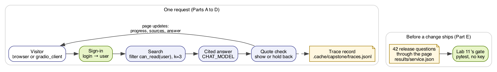

# Capstone: How to ship a RAG service with its release gate

[](https://colab.research.google.com/github/tatwan/rag_for_nlp/blob/main/Capstone_RAG_Service/capstone_rag_service.ipynb)

**CPU | API key: `OPENAI_API_KEY` (chat and embedding calls; the release gate needs none) | Practises: serving the
pipeline behind a web page, deciding who is asking, traces per request, and a release gate run on the service's own
results | Self-study**

## Goal

Put the pipeline you built behind a small web page that answers with citations and shows its sources and its trace,
and ship it only when Lab 11's release gate passes on the page's own results. The moment that teaches it: the first
page asked visitors who they are. A customer who answered *agent* read the support runbook's *4 hours* in 3 of 3
requests, through a permission filter that does exactly what Lab 11 tested, and hiding the field from the screen
changed nothing. The fix is a sign-in: the page, not the visitor, decides who is asking.

## What you will learn

- How to build and test the service's engine before any page: a permission filter, a cited answer, a quote check
  and one trace record per request.
- How to put the engine behind a Gradio page that shows its progress and shows the answer only after the quote check
  has run.
- How to test a page from code as several visitors with `gradio_client`, update by update.
- Why a page must take the user from a sign-in and never from a field the visitor fills, and how Gradio's `auth` does
  it.
- How to run the service from one file, `app.py`, on your route.
- How to run Lab 11's release gate on the service's own results, and in a CI job with no key.

## Coming from

[Lab 05](../05_Rebuild_With_LangChain/README.md) built the pipeline in `shared/lc_pipeline.py`,
[Lab 04](../04_Trace_And_Diagnose/README.md) saved a trace per question, and [Lab 11](../11_Release_Gate/README.md)
labelled who may read each document, filtered by permission before the search and wrote the release tests. This lab
puts that pipeline behind a page that people can use, and runs the same tests on what the page answered.

## What you will do

**Part A: Build the engine and test it before any page.** The labelled index, the permission filter, one answer with
its token count, the quote check, and one trace record per request, combined into `answer_and_trace()`.
**Part B: Put the engine behind a page that streams its progress.** A Gradio page that asks for the question and the
user, its three updates read from code with `gradio_client`.
**Part C: Decide who is asking.** A customer who says *agent*, the same with the field hidden, then a sign-in that maps
each login to a user, tested with three visitors.
**Part D: Run the service from `app.py`.** The file read, its functions compared with the notebook's, and how to start
it.
**Part E: Run the release gate on the service's results.** Lab 11's 42 release questions through the signed-in page,
`results/service.json`, the gate, the paired comparison, and the CI workflow.
**Going further.** Saving and loading the index, and the one-line change to a database store.
**Challenge.** Read the service's traces. Optional: stop a right answer from failing the quote check.



## Checkpoints

| After | You should see |
|---|---|
| Part A | 281 documents (277 `public`, 3 `staff`, 1 `internal`); the runbook question: customer H02, H01, H04, *30 minutes*; agent R04, R01, H02, *4 hours*; one trace line |
| Part B | three updates: *Searching...*, the three sources, then the answer with its quote and the trace |
| Part C | a customer who says *agent*: R04, R01, H02 and *4 hours*, 3 of 3, also with the field hidden; signed in: casey *30 minutes*, alex *4 hours*, 3 of 3 each; no sign-in: `AuthenticationError` |
| Part D | six functions, each `same as in the notebook: True` |
| Part E | 38 of 42 passed; `5 passed`; gained A01, A02, A03, lost none |

The saved outputs come from `gpt-4o-mini` and `text-embedding-3-small` at `https://api.openai.com/v1` on 19 Oct 2026
(macOS, Python 3.13.5, a fresh `uv sync --group capstone`; `gradio` 6.30.0, `gradio_client` 2.7.2, `langchain-core`
1.6.12, `langchain-openai` 1.7.2, `pytest` 9.1.1). Model replies vary between runs: compare who read what and which
tests pass, not every word.

**Across our runs.** Seven runs of Part E on `gpt-4o-mini`, the saved run among them. The service passed 38 of 42 and the gate said `5 passed` in all
seven, gaining A01 to A03 and losing nothing. The customer who said *agent* read R01 and got *4 hours* in every
request of the runs we read, with the field shown or hidden, because the search, not the model, decides what reaches
the pack. In four of the seven runs one answer failed the quote check and was shown under the warning: each time we
looked, the right answer *Von Miller forced two fumbles in Super Bowl 50.*, whose quote the model shortened with `...`.
Asked again and again, that answer failed the check 2 of 10, 7 of 15, 8 of 10, 5 of 10 and 6 of 10 times; with Task
2's line, 0 of 10 in each run with it. On the whole release set, though, the line moved the failure to another right
answer (*When did Tesla discover the possibility of wireless connectivity?*, a quote with one word added) in both runs
we tried. A fix can move a failure rather than remove it, so run the whole set after any change to the rules.

**On the other routes.** The `pip` run (Python 3.12.14, same package versions) gave the same results in every part.
With `gpt-6-luna` and `REASONING_EFFORT=none` the lab runs unchanged and the access moment is the same (R01 and *4
hours* in 6 of 6 for the customer who said *agent*), and three things differ. The customer's own runbook question is
refused (*Insufficient evidence.* in Part A, 1 of 3 for casey in Part C) instead of answered with *30 minutes*. The
service also passes 38 of 42, but different questions: it gains G05, G08 and G09 and loses three that Lab 11's baseline
passed (the Vistula animals, the meaning of *Norman*, answered with curly quotes that the reference check misses, and
G03, a refusal it now answers), so the gate says `2 failed, 3 passed` (refusals and regressions). Lab 11's saved
baseline comes from `gpt-4o-mini`: to judge a model change, run Lab 11 on the new model first and compare with that
baseline.

## Before you start

- **Lab 00 first,** then Labs 05 and 11: this lab uses `shared/lc_pipeline.py`, `shared/evals.py`, `paired()` from
  `shared/hybrid.py`, Lab 11's records file, its saved baseline and its `test_release.py`.
- **Install Gradio.** It is not in `requirements.txt`. With uv: `uv sync --group capstone` (a later plain `uv sync`
  removes it again). With pip, in your active `.venv`: `pip install "gradio>=6,<7"`. On Colab the notebook installs
  it.
- **Open the notebook:** on Colab with the badge above (add `OPENAI_API_KEY` under Secrets first); locally or in a
  codespace, open `capstone_rag_service.ipynb` and choose the `.venv` kernel. Run Setup and Config first.
- **Files:** `app.py` is the service; `release-gate.yml` is the CI workflow; the notebook writes
  `results/service.json` (the saved one comes from our run) and appends one trace line per request to
  `.cache/capstone/traces.jsonl`, which git ignores because traces hold what users asked.
- **Cost:** one short chat call per question answered (42 in Part E) and three embeddings of the corpus, well under one
  US cent on `gpt-4o-mini`; task 2 of the challenge adds 20 calls.

## Run the service

From the repository folder, with your key in `.env` (or in the environment):

```bash
uv run python Capstone_RAG_Service/app.py        # uv route, after uv sync --group capstone
python Capstone_RAG_Service/app.py               # pip route, with .venv active
```

It prints a new password for casey (a customer) and alex (an agent), then `* Running on local URL:
http://127.0.0.1:7860`. Open the address, sign in, and ask *How long can a support agent make an Atlas reset link
last?* as each user (open `/logout` to switch). Stop it with `Ctrl+C`. Gradio's sign-in needs the browser to accept the
page's cookies, which a private window in some browsers blocks. We started it this way on both routes and signed in
from `gradio_client` as each user.

- **GitHub Codespaces:** the dev container runs a plain `uv sync`, so run `uv sync --group capstone` in the
  codespace's terminal first. When `app.py` starts, VS Code forwards port 7860; open it from the **Ports** tab (the
  globe icon). The port stays private to your GitHub account unless you change its visibility.
- **Ubuntu VM:** as local. From your own computer, forward the port over SSH (`ssh -L 7860:127.0.0.1:7860 you@vm`),
  then open `http://127.0.0.1:7860` on your computer.
- **Colab:** `app.py` would block the notebook, so use the notebook's pages: they appear under the cell (`inline`).
  To open one in a separate tab or on another device, set `share=True` in `LAUNCH`: Gradio prints a public
  `https://...gradio.live` link that lasts up to a week, so share only the signed-in page.

We could not test the Codespaces and Colab steps here (no codespace or Colab session from this machine): they follow
the [Codespaces port forwarding](https://docs.github.com/en/codespaces/developing-in-a-codespace/forwarding-ports-in-your-codespace)
and [Gradio sharing](https://www.gradio.app/guides/sharing-your-app) documentation. Every check in the notebook runs
from code with `gradio_client`, so it works on every route without a browser.

## Run the gate in CI

The gate reads only saved results, so it needs no key. From the repository folder:

```bash
GATE_BASELINE=11_Release_Gate/results/baseline.json GATE_CANDIDATE=Capstone_RAG_Service/results/service.json python -m pytest 11_Release_Gate/test_release.py -q
```

`release-gate.yml` runs the same command in GitHub Actions on every pull request and push to `main`, on Python 3.12
after `pip install -r requirements.txt`. To switch it on, copy it to `.github/workflows/release-gate.yml` at the top of
your repository and commit it. Whoever changes the service runs Part E again and commits the new `results/service.json`
with the change, so the pull request fails when a release test does. We ran the workflow's two commands in a fresh
Python 3.12 environment with only `requirements.txt` installed: `5 passed`.

The notebook ends with a troubleshooting table: Gradio not installed, Gradio removed by a later `uv sync`, a wrong
password, a page launched without `auth=`, and `app.py` started without a key.

## Resources

- [Gradio: Interface](https://www.gradio.app/docs/gradio/interface) and
  [Request](https://www.gradio.app/docs/gradio/request): a function as a page, and who sent each request
- [Gradio: sharing your app](https://www.gradio.app/guides/sharing-your-app): `share=True` links, password-protected
  pages and `/logout`
- [Gradio: the Python client](https://www.gradio.app/guides/getting-started-with-the-python-client): `Client`,
  `predict`, `submit` and `view_api`
- [GitHub Actions: quickstart](https://docs.github.com/en/actions/writing-workflows/quickstart): where workflow files
  go and how they run
- [OWASP: LLM02 sensitive information disclosure](https://genai.owasp.org/llmrisk/llm022025-sensitive-information-disclosure/):
  why access control belongs before the model

Back to [the lab list](../README.md).
